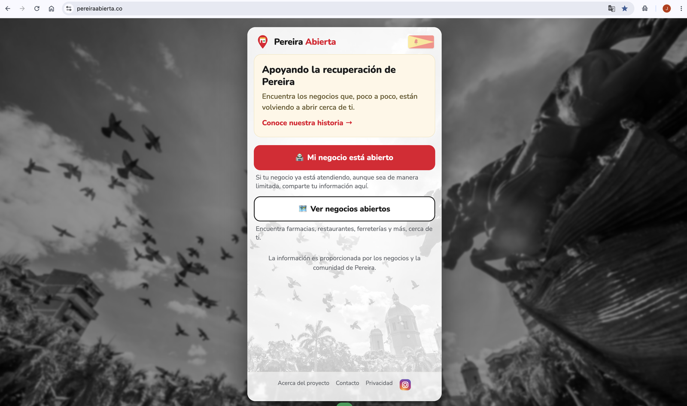
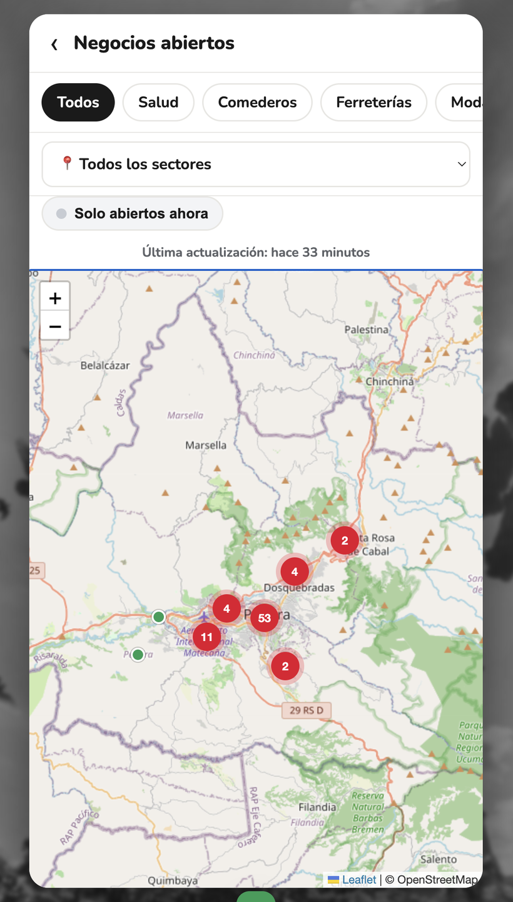
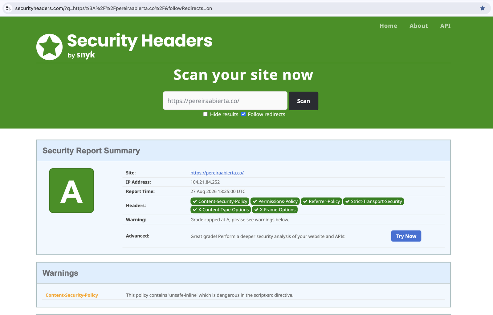
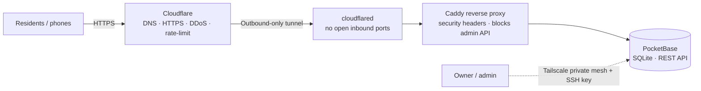

# Pereira Abierta

> A free, mobile-first community web app that maps small and medium local businesses that are open and operating in **Pereira, Colombia** after an emergency — so residents can quickly find what's open, and business owners can share their status.

**Live site:** https://pereiraabierta.co · **Instagram:** [@pereiraabierta](https://instagram.com/pereiraabierta)

  

---

## Why I built this

After an earthquake disrupted the city, it was hard for residents to know which local shops, pharmacies, and services were actually open — and small businesses had no easy way to signal "we're here, we're operating." Pereira Abierta is a lightweight, Spanish-language map that lets the community answer both questions in one place, for free.

It started as a way to repurpose a spare desktop into a self-hosted Linux web server, and grew into a full-stack, publicly reachable product — hardened along the way as a hands-on cybersecurity project. In September 2026 it migrated from that home server to a VPS for reliability, with under 60 seconds of downtime.

## Screenshots

| Home | Map | Security grade |
|---|---|---|
|  |  |  |

## Architecture

- **No inbound ports are open on the origin server.** The server reaches out to Cloudflare via an outbound-only tunnel, so the origin IP is hidden and there is nothing to port-scan.
- **Admin is never exposed to the public.** The PocketBase admin UI and non-public API paths are blocked at the Caddy edge; administration happens over a private Tailscale mesh with SSH key auth only.

## Tech stack

| Layer | Choice |
|---|---|
| OS | Ubuntu 24.04 LTS on a VPS (Vultr, Miami — chosen for latency to Colombia) |
| Backend | [PocketBase](https://pocketbase.io) (Go single binary, SQLite, REST API, admin UI) |
| Web server / proxy | [Caddy](https://caddyserver.com) |
| Public exposure | Cloudflare Tunnel (`cloudflared`), Cloudflare DNS + Email Routing |
| Remote admin | Tailscale (WireGuard mesh), SSH key-only |
| Frontend | Single self-contained HTML file — vanilla JS, [Leaflet](https://leafletjs.com) + markercluster, OpenStreetMap tiles, Nominatim geocoding |
| Hardening | UFW, fail2ban, unattended-upgrades, HTTP security headers, CSP |
| Backups | Nightly PocketBase snapshots to Cloudflare R2, 30-day retention, restore-verified |

## Features

- Interactive map of open businesses with **marker clustering** and status-colored pins
- Filter by **category** (Salud, Comederos, Ferreterías, Moda, Belleza, Tecnología, Mascotas, Hogar, Otros), by **sector/barrio**, and a **"Solo abiertos ahora"** toggle
- Self-service registration form with a **map location picker** (search address, use my location, drag the pin) and a confirm-your-location gate to keep pins accurate
- Business detail sheet with status, description, WhatsApp/phone, directions, and a report link
- Spanish-only, mobile-first, senior-friendly

## Security highlights

- Outbound-only Cloudflare Tunnel — **zero open inbound ports**, origin IP hidden
- Origin IP and domain are **unlinked** — no DNS record or TLS certificate associates them
- SSH is **not publicly reachable** — port 22 is firewalled to the Tailscale interface only; key-only auth with password and root login disabled, plus fail2ban and UFW default-deny behind that
- Admin UI / private API blocked at the edge; admin reachable only over Tailscale
- Anti-spam rate limiting at both Cloudflare and PocketBase (on real client IPs)
- Full set of HTTP security headers + a tuned Content-Security-Policy → **grade A** on [securityheaders.com](https://securityheaders.com/?q=pereiraabierta.co) (see [`docs/security-headers.md`](docs/security-headers.md))

## Docs

- [`docs/build-log.md`](docs/build-log.md) — the full build story: architecture decisions, a hardware-debugging detour, hardening, going live, and the security pass
- [`docs/security-headers.md`](docs/security-headers.md) — the header/CSP configuration and the A-grade result
- [`config/Caddyfile.example`](config/Caddyfile.example) — reverse-proxy + security-header config (sanitized)
- [`docs/pereira-abierta-vps-migration.md`](docs/pereira-abierta-vps-migration.md) — migrating off the home server to a VPS with under 60 seconds of downtime: provider selection, an `sshd_config` precedence trap that fails silently, the cutover, offsite backups, and decommissioning
- [`docs/incident-log-ssh-enumeration.md`](docs/incident-log-ssh-enumeration.md) — automated attacks found the new server 47 minutes after creation: distinguishing brute force from research scanning, RIPE attribution, and a measured before/after of attack surface

## What I learned

- Standing up and **hardening** a public Linux server end to end (attack surface, defense in depth, least privilege)
- Exposing a home service safely **without opening any ports** (tunnel + private mesh)
- Writing a **Content-Security-Policy** tuned to a real app, and debugging it from browser + `curl`
- Security software and VPN clients install kernel-level drivers that often don't uninstall cleanly — sometimes a clean OS install is faster and safer than piecemeal removal
- Migrating a **live stateful service** with near-zero downtime — and why tunnel replicas are a stateless-service pattern that would have caused silent data loss here
- Config that fails **silently**: `sshd_config.d` precedence meant a correctly written hardening file could have been ignored with no error
- A backup you haven't restored from is a hypothesis — verifying the archive, not just that it exists

## Built with Claude

This project was designed and built by **Jonathan Romero**, with **Claude** (Anthropic) as a pair-programming and advisory assistant across server setup, hardening, full-stack development, and documentation.

## License

[MIT](LICENSE) © 2026 Jonathan Romero
